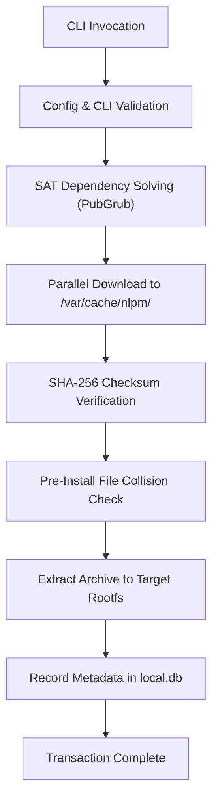

# Architecture & Internals

This document describes the internal modular architecture, data storage engines, transaction lifecycle, and design principles of `nlpm`.

---

## Architectural Principles

1. **Self-Contained Execution**: `nlpm` is a standalone binary executing directly within user space. It relies on POSIX filesystem APIs and SQLite transactional semantics rather than daemon processes or background services.
2. **Deterministic Resolution**: Dependency solving is separated from execution. The PubGrub solver computes a complete, conflict-free resolution plan before any archive is downloaded or unpacked.
3. **Fail-Safe Transactions**: Package installation maintains state invariants. File collisions are verified prior to unpacking, and database operations run inside SQLite transactions.
4. **Clean Abstractions**: Subsystems communicate through strictly defined C header interfaces. Low-level details (such as SQLite statement preparation or libarchive format filters) are encapsulated within their respective modules.

---

## Module Hierarchy

```text
src/
├── crypto/        # RFC-6234 compliant SHA-256 implementation
├── util/          # Memory collections, version parser, string utilities
├── config/        # TOML configuration loader and runtime options
├── db/            # SQLite abstraction for local and sync databases
├── pkg/           # .nlpkg archive reader, builder, and filesystem installer
├── net/           # HTTP/HTTPS client backed by libcurl multi interface
├── repo/          # Repository index generator and synchronization engine
├── solver/        # PubGrub SAT solver with CDCL unit propagation
├── cmd/           # Subcommand implementations
└── main.c         # CLI entry point and argument parsing
```

### Module Responsibilities

| Module | Purpose |
|---|---|
| `src/crypto/sha256.c` | Computes 256-bit cryptographic hashes for files, memory buffers, and streaming payloads. |
| `src/util/version.c` | Parses and compares SemVer strings with epochs and relational constraints (`>=`, `<=`, `=`, `>`, `<`, `!=`). |
| `src/util/stretchy_buffer.h` | Type-safe, dynamic array implementation for C with automatic geometric resizing. |
| `src/util/hash_map.c` | Open-addressing hash table for fast lookups. |
| `src/config/config.c` | Loads `/etc/nlpm/nlpm.toml` and populates `NlpmConfig` structures. |
| `src/db/db_local.c` | Manages `/var/lib/nlpm/local.db` tracking installed packages and file ownership. |
| `src/db/db_sync.c` | Manages `/var/lib/nlpm/sync.db` containing repository metadata and dependency trees. |
| `src/pkg/pkg_read.c` | Extracts `.PKGINFO` metadata and file listings from `.nlpkg` archives without full decompression. |
| `src/pkg/pkg_build.c` | Packages filesystem directories and manifests into `.nlpkg` archives. |
| `src/pkg/pkg_install.c` | Checks file conflicts, unpacks payloads into rootfs, and registers records in `local.db`. |
| `src/pkg/pkg_remove.c` | Validates reverse dependencies, deletes owned files, and unregisters packages. |
| `src/pkg/pkg_upgrade.c` | Transactional package upgrades: installs replacement before unlinking superseded files. |
| `src/net/net_download.c`| Parallel HTTP/HTTPS asset downloading with progress monitoring and SHA-256 validation. |
| `src/repo/repo_index.c` | Scans directories of `.nlpkg` files to generate compressed `<repo>.nldb` database files. |
| `src/repo/repo_sync.c`  | Unpacks `<repo>.nldb` archives and updates `sync.db`. |
| `src/solver/`           | Implements PubGrub SAT solver, term evaluation, and incompatibility derivation. |

---

## Database Architecture

`nlpm` utilizes two distinct SQLite 3 databases stored in `/var/lib/nlpm/`. Both databases operate under `PRAGMA foreign_keys = ON;` and `PRAGMA journal_mode = WAL;`.

### 1. Local Database (`/var/lib/nlpm/local.db`)

Tracks all packages currently installed on the host or target sysroot.

```sql
CREATE TABLE IF NOT EXISTS installed (
    id INTEGER PRIMARY KEY,
    name TEXT NOT NULL UNIQUE,
    version TEXT NOT NULL,
    reason TEXT NOT NULL DEFAULT 'explicit',
    install_date INTEGER
);

CREATE TABLE IF NOT EXISTS files (
    id INTEGER PRIMARY KEY,
    pkg_name TEXT NOT NULL REFERENCES installed(name) ON DELETE CASCADE,
    path TEXT NOT NULL UNIQUE
);

CREATE INDEX IF NOT EXISTS idx_files_path ON files(path);
```

- **`installed`**: Stores the unique package identifier, installed version, install reason (`explicit` vs `dependency`), and UNIX timestamp of installation.
- **`files`**: Maps canonical filesystem paths to package names. The `UNIQUE` constraint guarantees that two packages cannot claim ownership of the same file path simultaneously.

### 2. Synchronization Database (`/var/lib/nlpm/sync.db`)

Contains package metadata, dependency requirements, and repository definitions downloaded from remote mirrors.

```sql
CREATE TABLE IF NOT EXISTS repos (
    id INTEGER PRIMARY KEY,
    name TEXT NOT NULL UNIQUE,
    url TEXT NOT NULL,
    enabled INTEGER NOT NULL DEFAULT 1,
    last_sync INTEGER
);

CREATE TABLE IF NOT EXISTS packages (
    id INTEGER PRIMARY KEY,
    repo_id INTEGER NOT NULL REFERENCES repos(id) ON DELETE CASCADE,
    name TEXT NOT NULL,
    version TEXT NOT NULL,
    desc TEXT,
    arch TEXT NOT NULL,
    isize INTEGER,
    csize INTEGER,
    sha256 TEXT,
    filename TEXT,
    UNIQUE(repo_id, name)
);

CREATE TABLE IF NOT EXISTS deps (
    id INTEGER PRIMARY KEY,
    pkg_id INTEGER NOT NULL REFERENCES packages(id) ON DELETE CASCADE,
    kind TEXT NOT NULL,
    name TEXT NOT NULL,
    constraint_str TEXT
);

CREATE INDEX IF NOT EXISTS idx_packages_name ON packages(name);
CREATE INDEX IF NOT EXISTS idx_deps_pkg ON deps(pkg_id);
CREATE INDEX IF NOT EXISTS idx_deps_name ON deps(name);
```

---

## Transaction Lifecycle

Package installations and upgrades execute through a strict phased sequence:



### Pre-Install Collision Check
Before any file is unpacked onto the target filesystem:
1. `nlpm` inspects the archive entry table of the target package.
2. For each file path, it queries `local.db` (`SELECT pkg_name FROM files WHERE path = ?`).
3. If the path belongs to another package, the transaction aborts with a collision error, leaving the filesystem untouched.
4. For package upgrades, paths owned by the predecessor package are permitted.

---

## Error Handling & Safety

- **No Partial Installs**: If an archive extraction fails halfway through due to disk space exhaustion or permission errors, the operation is reported and aborted before committing to `local.db`.
- **Privilege Checking**: Commands modifying the system root (`/`) verify `geteuid() == 0`. When targeting an unprivileged directory via `-r <root_dir>`, root checks are bypassed.
- **Cryptographic Guardrails**: Archives failing SHA-256 verification against the signed repository metadata are immediately deleted from `/var/cache/nlpm/` and never executed or unpacked.
