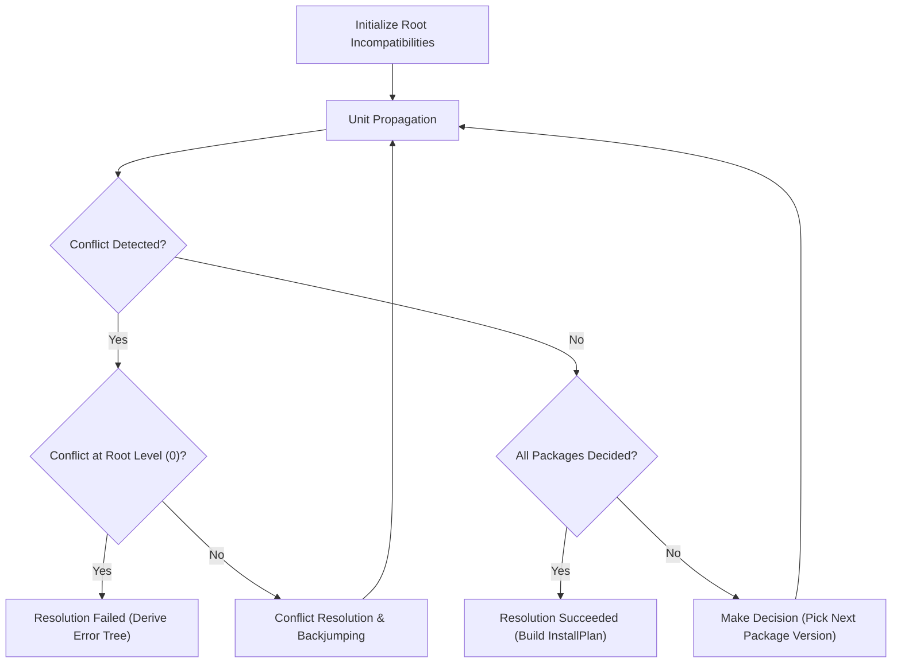

# PubGrub SAT Solver Engine

This document outlines the theory, implementation details, and conflict resolution mechanisms of the PubGrub SAT dependency solver embedded in `nlpm`.

---

## Overview

Traditional package managers rely on heuristic depth-first backtracking or external SAT/SMT solvers (such as MiniSat or Z3) translated via boolean satisfiability encodings. 

`nlpm` implements **PubGrub**, an algorithm derived from Conflict-Driven Clause Learning (CDCL). PubGrub operates directly on semantic version ranges rather than raw boolean variables, delivering:
- Guaranteed completeness (finds a valid solution if one exists, or proves impossibility).
- Clear, human-readable error messages explaining the exact chain of mutually incompatible dependencies when resolution fails.
- Fast solving through learned clauses and non-chronological backjumping.

---

## Core Concepts

### 1. Terms
A **Term** represents a package and a set of allowed versions:
- **Positive Term (`Term(pkg, [v1, v2])`)**: Indicates that `pkg` must be selected with a version within the range `[v1, v2]`.
- **Negative Term (`not Term(pkg, [v1, v2])`)**: Indicates that if `pkg` is selected, its version must *not* fall within `[v1, v2]`.

A term is evaluated against the current partial assignment to produce one of three states:
- `SATISFIED`: The assignment satisfies the term.
- `CONTRADICTED`: The assignment violates the term.
- `UNDECIDED`: The assignment does not contain enough information to determine satisfaction.

### 2. Incompatibilities
An **Incompatibility** is a set of terms that cannot all be true simultaneously. In boolean logic, an incompatibility `(T1, T2, ..., Tn)` is equivalent to the clause:

$$\neg (T_1 \land T_2 \land \dots \land T_n) \equiv (\neg T_1 \lor \neg T_2 \lor \dots \lor \neg T_n)$$

Examples of incompatibilities:
- **Package Dependency**: `Package A 1.0.0 depends on B >= 2.0.0` translates to the incompatibility:
  $$\{A = 1.0.0, \text{not } B \ge 2.0.0\}$$
- **Mutual Exclusion**: `Package A conflicts with Package C` translates to:
  $$\{A \ge 0, C \ge 0\}$$

### 3. Partial Assignment & Decision Trail
The solver maintains an ordered trail of assignments (`SolverAssignment *trail`):
- **Decision Assignment**: An arbitrary choice made by the solver (e.g. selecting `pkg X = 2.1.0` when multiple versions are available). Each decision increments the `current_level`.
- **Derivation Assignment**: An assignment deduced via unit propagation that *must* hold given preceding assignments.

---

## The Solving Loop



### 1. Unit Propagation
The solver iterates through all active incompatibilities:
1. If all terms except one are `SATISFIED`, and the remaining term is `UNDECIDED`, the remaining term must be `CONTRADICTED` to avoid a conflict. The solver immediately derives the negation of that term as an assignment.
2. If all terms in an incompatibility are `SATISFIED`, a **Conflict** has occurred.

### 2. Conflict Resolution & Learned Incompatibilities
When a conflict occurs:
1. The solver identifies the conflict clause (the incompatibility whose terms are all satisfied).
2. It examines the assignments in the trail that caused this conflict and computes the latest common cause.
3. A new **learned incompatibility** is derived by resolving the conflicting clauses.
4. The solver computes the backtrack level: the lowest decision level at which the new incompatibility is not fully satisfied.
5. It unwinds the trail to that level (**backjumping**) and adds the learned incompatibility to its database, ensuring that identical dead-end branches are never re-explored.

---

## Handling Diamond Dependencies

A classic challenge in dependency resolution is the diamond dependency problem:

```text
       Root
      /    \
     A      B
      \    /
       C
```

Suppose:
- `Root` requires `A >= 1.0` and `B >= 1.0`.
- `A 1.0.0` requires `C >= 2.0.0`.
- `B 1.0.0` requires `C < 2.0.0`.

When PubGrub encounters this:
1. Decision: Select `A 1.0.0` at Level 1 $\rightarrow$ Propagate `C >= 2.0.0`.
2. Decision: Select `B 1.0.0` at Level 2 $\rightarrow$ Propagate `C < 2.0.0`.
3. Incompatibility conflict: `C` cannot simultaneously satisfy `C >= 2.0.0` and `C < 2.0.0`.
4. Conflict resolution derives that `{Root, A 1.0.0, B 1.0.0}` is mutually incompatible.
5. The solver backjumps to Level 1, discards `B 1.0.0`, and attempts to select alternate versions of `B` or `A` that agree on `C`.
6. If no versions satisfy the constraint, PubGrub produces a deterministic explanation of the conflicting requirements.

---

## Implementation Structures (`src/solver/`)

- `Term`: Defined in `src/solver/term.c` with support for exact, range, and wildcard version bounds.
- `Incompatibility`: Defined in `src/solver/incompat.c` tracking causes (external dependency vs derived conflict).
- `Solver`: Defined in `src/solver/solver.c` managing the assignment stack, SQLite metadata queries from `sync.db`, and backjumping mechanics.
